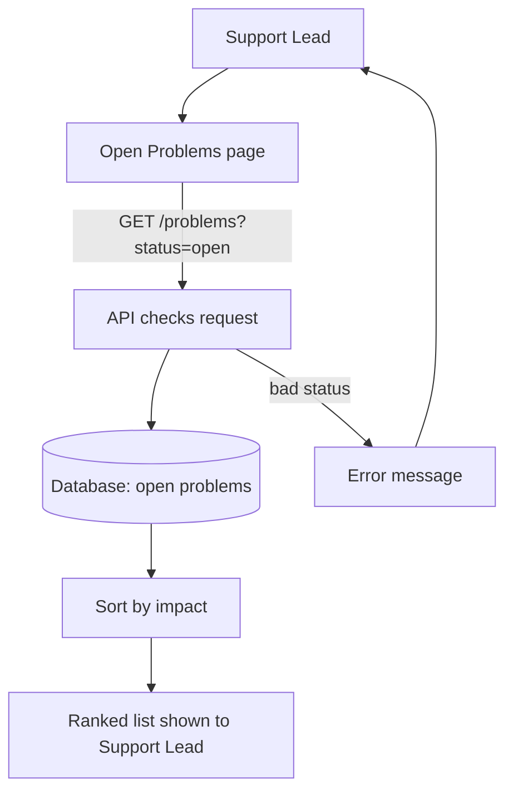
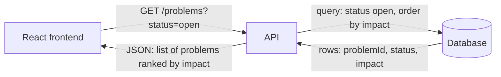

# T7B Design - Card 3: See Open Problems

**Group members and roles:**
- Diagrammer: John Sanchez
- Contract Writer: Ben Coppage
- Story Checker: Freeda Garcia
- Presenter: RayMond Hall

## User story
> As an IT Branch Operations Support Lead, I want to see open problems ranked by impact, so that my team fixes the most damaging issues first.

## Story breakdown
- **Inputs:** a request for problems with status open
- **Process:** the page calls the API, the API checks the request, reads open problems from the database, and sorts them by impact
- **Outputs (success):** a ranked list of open problems, highest impact first
- **Outputs (failure):** an error message if the status is bad
- **Interface:** `GET /problems?status=open`

## Workflow diagram

## Component diagram

## Contract
See `schema.json`.

## Traceability
| Story phrase | Where it shows up in the design |
| --- | --- |
| "open problems" | `status` field in the schema, limited to `open` |
| "problems" | `problemId` field, one item per problem |
| "ranked by impact" | `impact` field, an integer so it can sort |
| "ranked by impact" | "Sort by impact" box in the workflow diagram |
| `GET /problems?status=open` | the arrow label in the component diagram |

## What we changed after feedback
- ___ because ___
